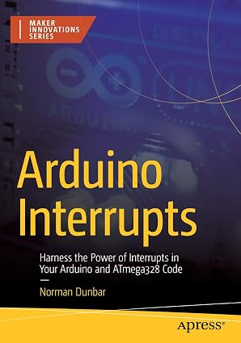

My latest book, _Arduino Interrupts_ is now available to read as a paper copy, or as a Kindle or eBook variant.

It's all about the twenty, or so, interrupts that you can use on an ATmega328P, the microcontroller at the heart of the mega-popular Arduino Nano and Uno R3 development bpards.



* [Get it from Apress](https://link.springer.com/book/10.1007/978-1-4842-9714-8)
* [Get it from Amazon UK](https://www.amazon.co.uk/Arduino-Interrupts-Harness-ATmega328-Innovations/dp/148429713X)

### From the Back Cover

Improve your projects by leveraging the power of interrupts. This comprehensive guide makes it easy to understand and use interrupts with the ATmega328P microcontroller found on Arduino boards.

With over 20 interrupts available, this book covers almost all of them and provides background information on how they work. You’ll work through the steps and code examples required to configure each of the covered interrupts. You'll also learn how to use them with Arduino, AVR C++ and with other development systems, like PlatformIO.

Interrupts can be intimidating, but by the end of this book, you will have the knowledge and skills to take full advantage of them and improve the performance and efficiency of your Arduino projects.

### Example Sketch

The sketch below shows how the ATmega328p's Watchdog Timer Interrupt can be configured to trigger every second. The interrupt handler will be used to toggle the obligatory LED every time the interrupt is triggered.

#### Configuring the Watchdog

```C
#include "avr/wdt.h"

void WDT_Interrupt(uint8_t timeout) {
    // Save global interrupt flag as we need to restore it to
    // how it was before we turned interrupts off.
    uint8_t oldSREG = SREG;

    // Set the prescaler bits. Get the validated timeout into
    // the correct bits of the wdt_setting variable.
    uint8_t wdt_setting;
    timeout = (timeout > 9) ? 9 : timeout;
    wdt_setting = (timeout > 7) ? (1 << WDP3) : 0;
    wdt_setting |= (timeout & 7);

    // Disable Interrupts. We don;t want to be interrupted as
    // we are configuring the interrupt itself!
    cli();

    // Reset WDT. In case it is running and ready to reset 
    // the board.
    wdt_reset();

    // Clear RESET by WDT flag. Because we *must* do this.
    MCUSR &= ~(1 << WDRF);

    // Do the timed sequence. We have 4 clocks to complete
    // the configuration.
    WDTCSR |= ((1 << WDCE) | (1 << WDE));

    // Enable interrupts but do not allow the WDT to reset
    // the board, just trigger an interrupt.
    WDTCSR = (wdt_setting) | (1 << WDIE);

    // REstore global interrupt flag as it was before we 
    // disabled interrupts.
    SREG = oldSREG;
}
```

#### The `setup()` Function
```C
void setup() {
    // The builtin LED on D13 is an OUTPUT.
    pinMode(LED_BUILTIN, OUTPUT);
    
    // Configure the Watchdog Timer & its interrupt.
    WDT_Interrupt(WDTO_1S);
}
```

#### The `loop()` Function

```C
void loop() {
    // Do nothing at all here. The interrupt handler does all
    // the hard work of toggling the builtin LED.
}
```

#### The Watchdog Timer Interrupt Handler

```
ISR(WDT_vect) {
    // The Watchdog Timer Interrupt handler. It *must* have
    // the name given here WDT_vect, in exactly that letter
    // case. If not, nothing will blink!
    //
    // All we do here is toggle the builtin LED.
    digitalWrite(13, !digitalRead(13));
}
```

Enjoy.
