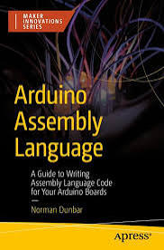

I have a new book out! _Arduino Assembly Language_.




* Get it from [Apress](https://link.springer.com/book/10.1007/979-8-8688-2442-5).

* Get it from [Amazon UK](https://www.amazon.co.uk/Arduino-Assembly-Language-Writing-Innovations/dp/B0G6JXT311).

The book will teach you everything you never knew you needed to know about Assembly Language on the Arduino Uno R3 and other boards with the ATmega328P.

### From the Back Cover

This book explores how to use Assembly Language within your Arduino sketches, directly from the Arduino IDE, without any external tools. By learning to write low-level code, you’ll gain the ability to reduce sketch size, increase execution speed, and achieve precise timing control, especially useful for tasks like bit-banging communication protocols.

It’s designed to be both educational and practical, helping developers and makers to reduce the size of their sketches, increase the speed of execution, and to get a much better understanding of how the Arduino hardware works. With a focus on clarity and hands-on examples, it’s ideal for developers and makers who want to push their Arduino projects further and gain deeper insight into microcontroller programming.

### Example Sketch

The code below is created as a library, in the book, to allow easy access to the Watchdog Timer, and its ability to reset the board when it hangs up, as well as triggering an interrupt at regular intervals. For the sake of this example, just add the files to the skect and don't worry about the original library.

#### The `setup()` Function

```C
#include "wdt_test.h"

void setup() {
    // The builtin LED is an OUTPUT.
    pinMode(13, OUTPUT);

    // Call the Assembly code to configure the WDT in interrupt
    // mode only (no resetting the board allowed) with an
    // interrupt generated every half-second.
    wdtEnable((wdtTO_500MS << 8)|(wdtMode_Interrupt));
}
```

#### The `loop()` Function

```C
void loop() {
    // Nothing to do here. Ideally, the board
    // would be put to sleep.
}
```

#### The Watchdog Timer Interrupt Handler

```C
// The WDT Interrupt Handler just toggles the built-in LED
// every time the Watchdog triggers an interrupt.
ISR(WDT_vect) {
    // Toggle D13/PB5.
    PINB |= (1 << PINB5);
}
```


#### The Header File

In the Arduino IDE, click the button with three dots on it (...) and select "New Tab". Give the tab the name `wdt_test.h` and paste the code below into that tab.

```C
#ifndef WDT_H
#define WDT_H

#include <avr/io.h>

// We have to define our own constants to match the
// bit patterns for the various timeouts in the WDTCSR 
// register.

// Timeout macros.
#define wdtTO_16MS 0
#define wdtTO_32MS 1
#define wdtTO_64MS 2
#define wdtTO_125MS 3
#define wdtTO_250MS 4
#define wdtTO_500MS 5
#define wdtTO_1S 6
#define wdtTO_2S 7
#define wdtTO_4S 32
#define wdtTO_8S 33

// Watchdog modes.
#define wdtMode_Off (0 << WDE)|(0 << WDIE)|(0 << WDCE)
#define wdtMode_Reset (1 << WDE)
#define wdtMode_Interrupt (1 << WDIE)|(1 << WDIF)
#define wdtMode_ResetInterrupt (1 << WDE)|(1 << WDIE)|(1 << WDIF)

// Special timed sequence.
#define wdtTimed (1<<WDCE) | (1<<WDE)

// Functions in the library.
#ifdef __cplusplus
  extern "C" {
    void wdtReset();
    void wdtDisable();
    void wdtEnable(uint16_t param);
  }
#endif //__cplusplus

#endif // WDT_H
```

#### The Watchdog Code

In the Arduino IDE, click the "..." button again and select "New Tab". Give the tab the name `wdt_test.S` (The extension of the filename *must* be an uppercase `S`, not a lowercase one. Paste the code below into that tab.

```C
#include "wdt_test.h"

;----------------------------------------------------------
; Globally visible functions.
;----------------------------------------------------------
.global wdtEnable
.global wdtReset
.global wdtDisable

;----------------------------------------------------------
; Code section.
;----------------------------------------------------------
.section .text

;----------------------------------------------------------
; wdtEnable((Timeout << 8)|(mode));
;
; Enables the Watchdog with a given mode and timeout.
; R24:R25 hold a 16 bit parameter made up of the timeout in
; R25 and the mode in R24: (Timeout << 8)|(mode).
;----------------------------------------------------------
wdtEnable:
    andi r25,0b00100111        ; Keep only valid timeout bits.
    andi r24,0b11011000        ; Keep only valid mode bits.
    
wdtConfigure:
    ; Merge the timeout and mode to configure the watchdog.
    or r24,r25                 ; Combine timeout with mode.
    sbr r24,(1 << WDIF)        ; Clear pending WDT interrupts.
    in r25,_SFR_IO_ADDR(SREG)  ; Get current interrupt status.
    push r25                   ; And save it.
    cli                        ; Interrupts must be off.
    wdr                        ; Reset Watchdog if running.
    ldi r25,wdtTimed           ; Must set WDCE|WDE = 1.
    sts _SFR_MEM_ADDR(WDTCSR),r25  ; Timed sequence.
                                   ; 4 clocks countdown...
    sts _SFR_MEM_ADDR(WDTCSR),r24  ; New timeout and mode.
    pop r25                     ; Get interrupt status again.
    out _SFR_IO_ADDR(SREG),r25  ; And reconfigure as they were.
                                ; Drop into wdtReset.
                            
;----------------------------------------------------------
; wdtReset();
;
; Reset the Watchdog to prevent inadvertent resets.
;----------------------------------------------------------
wdtReset:
    wdr                        ; Reset the timeout counter.
    ret
    
;----------------------------------------------------------
; wdtDisable();
;
; Turns off all three Watchdog modes. Also resets the 
; timeout to 16 milliseconds.
;----------------------------------------------------------
wdtDisable:
    ; Clear WDRF or we can't clear WDE later.
    in r24,_SFR_IO_ADDR(MCUSR)   ; Get current value.
    cbr r24,(1 << WDRF)          ; Clear WDRF bit.
    out _SFR_IO_ADDR(MCUSR),r24  ; Write back.
    
wdtOn:
    ; For the mode, we want WDE = WDIE = WDCE = 0, but no harm 
    ; in all bits being cleared.
    ldi r24,wdtMode_Off        ; Disable the Watchdog. 
    ldi r25,wdtTO_16MS         ; Shortest timeout period.
    rjmp wdtConfigure          ; Go turn off the Watchdog.
```

In the book, the latter two files---with slightly different names---have been used to build an Assembly Language library for installation into the IDE. That way, you don't need to add the two files to _every_ sketch that needs access to the Watchdog Timer.


