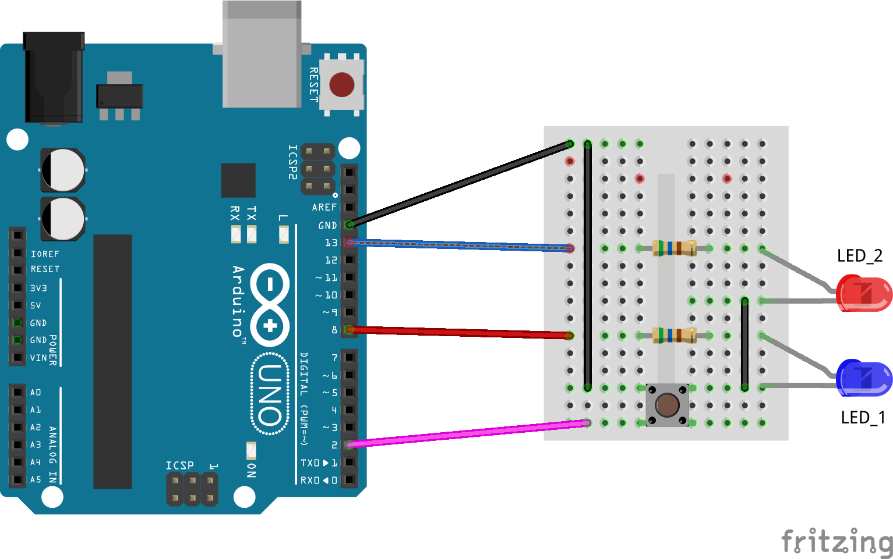

## Introduction

Switches need debouncing, usually. This is especially true if you are using Arduino Interrupts as even at the Arduino's paltry 16 MHz clock speed, it can react to an interrupt from a bouncing switch many, many times. This will, inevitably lead to your LEDs not working when the switch is pressed, or flickering at all the wrong times.

Basically, if you are reading the switch to toggle an LED on each press, then if there are an even number of bounces, the LED will appear not to change. If there is an odd number, then the LED will appear to work. The problem is, the number of bounces is not consistent, and the results can appear random.

You could write a software delay to react to the first press, then wait for the switch to stop bouncing, then read it again to get the "final" state of the switch. The problem with this method is that the delay is hard coded and might not work for every switch. To change the delay needs a recompile of the code. In addition, if the delay gets too long, the switch might appear to be unresponsive, so the user may "hammer" it multiple times just to get a result.

Another workaround is to use external components to debounce the switch. This could be as simple as a couple of resistors, a diode and a Schmidt trigger; or you could use a MC14490P Hex Contact Bounce Eliminator IC to debounce up to six separate switches.

There's no need! You can debounce one or more switches without resorting to unreliable delays or costly external components. In addition, the switch will respond correctly, no matter how often the user hammers it!

## Caveats

This method works for up to two switches attached to `D2` or `D3` *only*. If you need more switches, you will need to consider configuring Pin Change Interrupts instead of the `INT0`/`INT1` interrupts used here.

The reaction to the button press will be delayed for as long as it takes the `loop()` to execute. If a single pass through `loop()` takes two seconds, then there will be a maximum of two seconds between the button press and the reaction to it. If the loop is short, then so will the delay between action and reaction.

This method is not suitable for use as an emergency stop button because of the delay mentioned. For that, you definitely need an interrupt and handler to ensure that the button press is acted upon _immediately_.

## How It Works

In [the demonstration sketch](/downloads/Debounce_Events.zip), we will connect a single button switch to `D2` and configure it as `INPUT_PULLUP` to ensure it has a fixed "resting" state---never have input connections floating, it's asking for trouble. An LED's anode will be connected to `D8` via a 560R resistor, the cathode will connect to GND.

`D13` has the usual built in, and tiny, LED on the Arduino board itself. You can, if you wish, connect an external LED to this pin. Use another 560R resistor to limit current.

The `setup()` function will configure the switch and the LED, and, will also configure the settings for an INT0 interrupt. The interrupt will be configured to trigger on `D2` going from `HIGH` to `LOW` *at any time, even in a `delay()` function call*. The INT0 interrupt, however, will not be enabled, only configured.

When the button is pressed, the ATmega328P notices, as if an interrupt had triggered, but only the interrupt flag is set. And this is where the debouncing happens. No matter how often the switch bounces, or the user hammers on it, the flag will (can!) only be set once.

The code in the `loop()` function might be in the middle of doing some useful work, or even, executing  the `delay()` function, it makes no difference. Once it gets around to checking the INT0 flag bit in the EIFR register, it will respond to the switch press, and toggle the LED.

Because we don't have an interrupt handler configured, the flag bit remains set. Had there been a handler present, the bit would be cleared immediately, and would therefore be able to register another press (or bounce) and this is the cause of the code not working correctly.


## Connections

The wiring of the components is as follows:

**LED Connections**

D8 --> 560R --> LED_1+ 
LED_1- --> GND

**Optional LED Connections**

D13 --> 560R --> LED_2+   (Optional)
LED_2- --> GND            (optional)

**Switch Connections**

D2 --> SW+ 
SW- --> GND

See also the Fritzing generated breadboard diagram, `INT0_INT1_Debounce_Events.png`, elsewhere.


## Arduino Code

At the global level, we have a few definitions for the button and the LEDs we use. Here we also define our interrupt flag bit in the `EIFR` register.

```
//--------------------------------------------------------
// The EIFR bit we care about, plus LEDs and switches.
//--------------------------------------------------------
const uint8_t INT_FLAG = (1 << INT0);
const uint8_t LED_1 = 8;
const uint8_t LED_2 = LED_BUILTIN;
const uint8_t BUTTON = 2;
```

Next, in the `setup()` function, we need to configure our LED and Switch connections. As I mentioned, it's not necessary to configure the switch as an input as we are "sort of" using interrupts, but it does make things better documented _and_ we can configure the switch as `INPUT_PULLUP` to let us use a `FALLING` interrupt trigger.

```
    //--------------------------------------------------------
    // Configure the switch on D2 and LEDs. It's not strictly
    // necessary to configure the switch, but we need pullups
    // enabled. We could use external resistors, of course, to
    // pull the switch on D2 up or down.
    //--------------------------------------------------------
    pinMode(LED_1, OUTPUT);
    pinMode(LED_2, OUTPUT);
    pinMode(BUTTON, INPUT_PULLUP);

    //--------------------------------------------------------
    // Configure an INT0 interrupt on D2. We don't enable the
    // interrupt though as we will use a scan to check if the
    // switch on D2 was pressed "at some point". If so, we 
    // will toggle the LED on D8.
    // 
    // The EICRA.ISC01 and EICRA.ISC00 bit settings are:
    //
    // 00 = LOW (LEVEL, must be held low or nothing happens)
    // 01 = CHANGE
    // 10 = FALLING <--- We are using this one.
    // 11 = RISING
    //
    // As the switch is pulled up, we look for a
    // FALLING change on it.
    //--------------------------------------------------------
    // We have to talk directly to the registers here as there
    // is nothing in the Arduino Language that will do this
    // for us without enabling the INT0 interrupt. We only
    // want to *configure* the interrupt, not *enable* it.
    //--------------------------------------------------------
    EICRA = (1 << ISC01) | (0 << ISC00);      /* INT0 */
}
```

The `loop()` function, in the sketch, simply checks to see if anyone, at any time, pressed the switch and if so, toggles the LED on `D8`. If this is detected, the flag bit for the INT0 interrupt *must* be cleared by writing a 1 to it. This is necessary because the sketch is not triggering an interrupt. If we didn't clear it, it would constantly remain set so the LED would toggle each time through the `loop()`.

Regardless of whether or not the button was pressed, we toggle the built in LED on `D13`, and call `delay()` with a one second timeout. Normally, we would not use `delay()` in this manner---even given all the "blinky" examples out there---as the board is tied up for the duration of the delay call. We would use `millis()` and check if the delay has passed yet, in an ideal world, but I wanted to demonstrate that it still works, even with a `delay()` call in the code.

```
void loop() {

    //--------------------------------------------------------
    // See if an "interrupt" occurred on D2 or D3. Pressing
    // the switch should change the EIFR.INT0 bit. The flag
    // bit will need to be manually cleared by the code as we
    // are not triggering the INT0 interrupt.
    //
    // Once again, we need to talk directly to the registers.
    //--------------------------------------------------------
    if (EIFR & INT_FLAG) {
        // Clear the INT0 interrupt flag.
        EIFR |= INT_FLAG;

        // Toggle D8 when the button press is noticed.
        digitalWrite(LED_1, !digitalRead(LED_1));
    }

    //--------------------------------------------------------
    // At this point, the code should be off doing a bit of
    // useful work, only checking the switch every so often.
    // We could insert a delay here to simulate the work done,
    // I tested with delays from 10 up tp 5000 and it "just"
    // works. In actual fact, no delay is necessary, but if
    // you have one of a decent length, you will note that the
    // switch does respond correctly, even if a delay is
    // noticed.
    //--------------------------------------------------------
    // NOTE: The switch will respond with a press once and
    // once only no matter how often the user hammers it, or 
    // no matter how bouncy the switch is. As soon as it goes
    // low when pressed, the EIFR.INT0 bit is set to indicate
    // a press. This bit is what we look for instead of always
    // reading the switch when we want to know if it was 
    // pressed.
    //--------------------------------------------------------
    // To simulate "real" work, we toggle the built in LED
    // once every second, and yes, we are using a delay! In
    // normal circumstances, the user would have to press the 
    // button in the time between the final delay() ending and 
    // the next one beginning otherwise the press would be
    // missed. With this setup, the press doesn't go missing
    // and the D8 LED will toggle when the built in LED next
    // toggles, assuming the button has indeed been pressed.
    //--------------------------------------------------------
    digitalWrite(LED_2, !digitalRead(LED_2));


   //--------------------------------------------------------
   // This delay(), as well as determining when the built in
   // LED will toggle, also determines when the button press
   // will be acted upon.
   //
   // It should be noted that such a setup is NOT SUITABLE if
   // the code is monitoring a safety cutout switch, for that
   // you defintely need an interrupt and handler.
   //--------------------------------------------------------
    delay(1000);
}
```

## Breadboard Layout

The breadboard layout used for this sketch is as follows:



Have fun.

